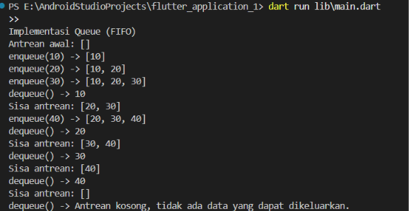

# Tugas Praktikum Pemrograman Mobile - Modul 1
## Implementasi Struktur Data Queue (FIFO) Menggunakan Bahasa Dart

Repository ini berisi implementasi struktur data **Queue (Antrean)** berbasis prinsip **FIFO (*First In, First Out*)** menggunakan bahasa pemrograman Dart sebagai pemenuhan penugasan praktikum Modul 1 Pemrograman Mobile.

---

## 👤 Identitas Mahasiswa

| Informasi | Keterangan |
| :--- | :--- |
| **Nama** | Bunga Budi Ambar Wati |
| **NIM** | H1D024006 |
| **Shift KRS** | H |
| **Program Studi** | Informatika |


---

## 📌 Deskripsi Tugas

Penugasan Modul 1 menginstruksikan pembuatan sebuah `class Queue` dengan ketentuan:
1. Memiliki method **`enqueue(element)`**: untuk memasukkan data baru ke bagian belakang antrean.
2. Memiliki method **`dequeue()`**: untuk mengeluarkan data paling depan dari antrean sesuai prinsip FIFO (*First In, First Out*).
3. Penanganan kondisi batas: jika antrean kosong dan dilakukan `dequeue()`, sistem akan memberikan pesan bahwa antrean kosong dan tidak ada data yang dapat dikeluarkan.

---

## 📁 Struktur Direktori

```text
flutter_application_1/
├── assets/
│   └── output.png            # Screenshot hasil output eksekusi program
├── bin/
│   ├── all_modul1.dart       # Kumpulan latihan materi dasar Modul 1
│   └── ...                   # File latihan per subbab modul
├── lib/
│   └── main.dart             # Implementasi class Queue dan pengujiannya
├── pubspec.yaml              # Konfigurasi dependensi project
└── README.md                 # Dokumentasi dan identitas tugas
```

---

## 🚀 Cara Menjalankan Program

Buka terminal pada direktori root project, lalu jalankan perintah:

```bash
dart run lib\main.dart
```

---

## 📋 Hasil Output Eksekusi



