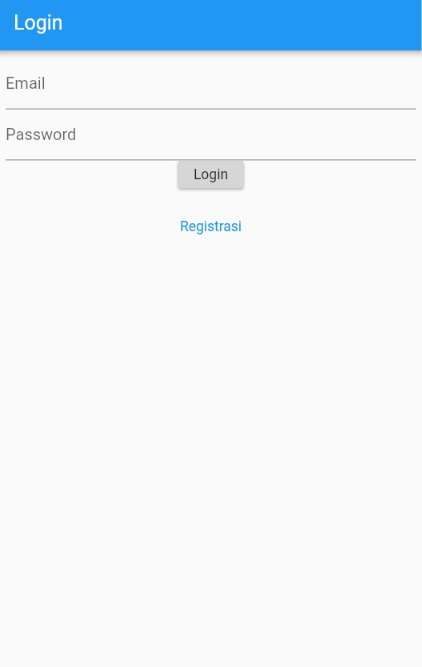
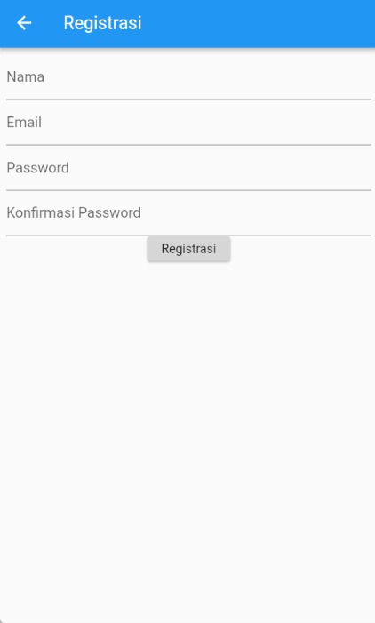
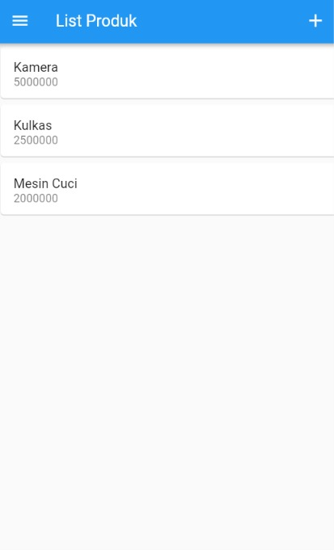
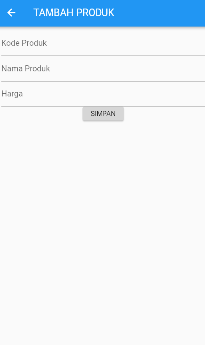
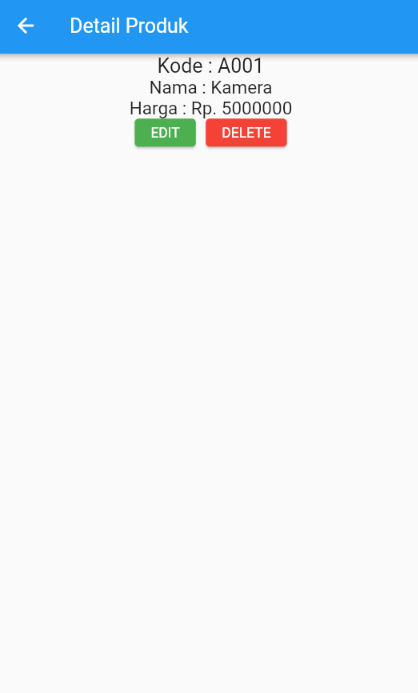
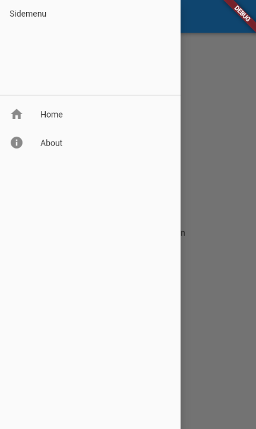
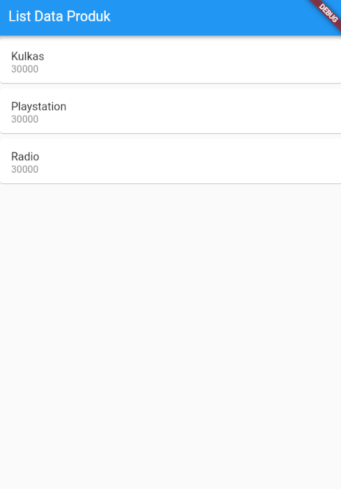
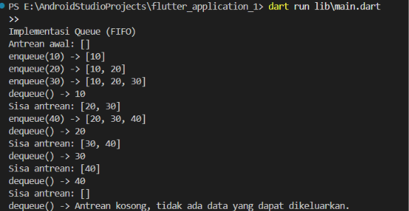

# Tugas Praktikum Pemrograman Mobile

Repository ini berisi hasil pengerjaan penugasan **Modul 4: Operasi CRUD dan Antarmuka Tokokita**, **Modul 3: Routes, Side Menu, Login dan Local Storage**, **Modul 2: Pengenalan dan Desain Framework Flutter**, serta arsip implementasi **Modul 1: Struktur Data Queue (FIFO)** pada project `flutter_application_1`.

---

## 👤 Identitas Mahasiswa

| Informasi | Keterangan |
| :--- | :--- |
| **Nama** | Bunga Budi Ambar Wati |
| **NIM** | H1D024006 |
| **Shift KRS** | H |
| **Program Studi** | Informatika |

---

## 🚀 Cara Menjalankan Aplikasi

Pastikan dependensi telah terpasang dengan menjalankan `flutter pub get`.

### 1. Menjalankan via Browser (Chrome / Edge)
```bash
flutter run -d chrome
```

### 2. Menjalankan via Windows Desktop
```bash
flutter run -d windows
```

### 3. Menjalankan via Android (Device Fisik / Emulator)
```bash
flutter run
```

### 4. Menjalankan Pengujian Otomatis
```bash
flutter test
```

> **Catatan:** Halaman awal aplikasi pada `lib/main.dart` saat ini mengarah ke `LoginPage` (Modul 4 Tokokita).

---

## 🛒 Modul 4: Operasi CRUD dan Antarmuka Tokokita

Pada modul ini dibangun antarmuka aplikasi **Tokokita** yang mencakup pembuatan model data (Login, Registrasi, Produk) dan komponen halaman pengguna (UI) untuk alur autentikasi dan pengelolaan produk.

### Struktur File Modul 4

| Kategori | File | Deskripsi |
| :--- | :--- | :--- |
| **Model** | [`lib/model/login.dart`](lib/model/login.dart) | Model data autentikasi login (token, userID, userEmail) dan factory mapping JSON |
| | [`lib/model/registrasi.dart`](lib/model/registrasi.dart) | Model data registrasi pengguna baru |
| | [`lib/model/produk.dart`](lib/model/produk.dart) | Model data entitas produk (`id`, `kodeProduk`, `namaProduk`, `hargaProduk`) |
| **UI** | [`lib/ui/login_page.dart`](lib/ui/login_page.dart) | Form login dengan validasi email dan password serta navigasi ke registrasi |
| | [`lib/ui/registrasi_page.dart`](lib/ui/registrasi_page.dart) | Form registrasi dengan validasi nama (min. 3 karakter), regex email, password (min. 6 karakter), dan konfirmasi password |
| | [`lib/ui/produk_page.dart`](lib/ui/produk_page.dart) | Halaman katalog list produk, tombol tambah (+), dan drawer dengan menu logout |
| | [`lib/ui/produk_form.dart`](lib/ui/produk_form.dart) | Form dinamis untuk menambah produk baru atau mengubah (edit) data produk yang dipilih |
| | [`lib/ui/produk_detail.dart`](lib/ui/produk_detail.dart) | Menampilkan detail spesifikasi produk beserta tombol aksi **EDIT** (hijau) dan **DELETE** (merah) |

---

### Hasil Tampilan Antarmuka Modul 4

#### 1. Halaman Login
Menampilkan form login dengan input email, password, tombol Login abu-abu, dan link navigasi Registrasi.

<p align="center">
  
</p>

#### 2. Halaman Registrasi
Menampilkan form registrasi pengguna baru lengkap dengan validasi di setiap inputan.

<p align="center">
  
</p>

#### 3. Halaman List Produk
Menampilkan daftar produk berupa kartu (Card), tombol penambahan produk pada AppBar, dan drawer menu samping.

<p align="center">
  
</p>

#### 4. Form Tambah / Ubah Produk
Formulir input untuk memasukkan data kode produk, nama produk, dan harga produk.

<p align="center">
  
</p>

#### 5. Halaman Detail Produk
Menampilkan rincian data produk terpilih beserta tombol aksi **EDIT** (warna hijau) dan **DELETE** (warna merah) serta konfirmasi penghapusan.

<p align="center">
  
</p>

---

## 🔐 Modul 3: Routes, Side Menu, Login, dan Local Storage

Pada modul ini dibuat alur aplikasi dengan halaman login, halaman home, dan side menu (drawer) untuk berpindah halaman. Username yang berhasil login disimpan di local storage memakai package `shared_preferences`, lalu ditampilkan di halaman home.

| File | Fungsi |
| :--- | :--- |
| `lib/login_page.dart` | Form login, validasi, dan menyimpan username |
| `lib/home_page.dart` | Halaman utama, menampilkan username dari local storage |
| `lib/sidemenu.dart` | Drawer berisi menu Home dan About |
| `lib/about_page.dart` | Halaman About |

Login memakai akun simulasi `admin` / `admin`.

### Tampilan Halaman Login

<p align="center">
  
</p>

### Tampilan Pop-up Notifikasi

Pop-up muncul setelah tombol login ditekan, berisi pesan berhasil atau gagal login.

<p align="center">
  
</p>

### Tampilan Halaman Home

<p align="center">
  
</p>

### Tampilan Side Menu

<p align="center">
  
</p>

---

## 📸 Hasil Tampilan Antarmuka (Modul 2)

Berikut adalah hasil tampilan antarmuka halaman **List Data Produk** (`ProdukPage`) pada Modul 2:

<p align="center">
  
</p>

---

## 📋 Lampiran Modul 1 (Implementasi Queue FIFO)

Implementasi struktur data Queue berbasis FIFO dari Modul 1 tersimpan di [`lib/main_backup.dart`](lib/main_backup.dart).

Program dapat dijalankan melalui terminal:
```bash
dart run lib/main_backup.dart
```

Hasil eksekusi Modul 1:

<p align="center">
  
</p>