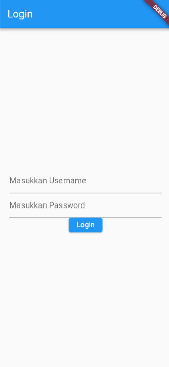
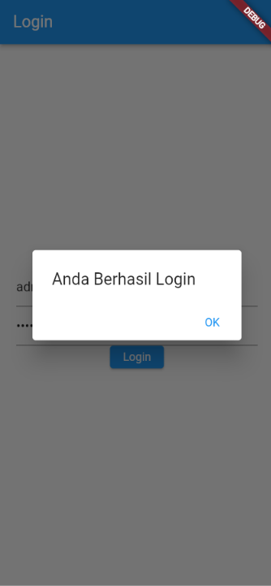
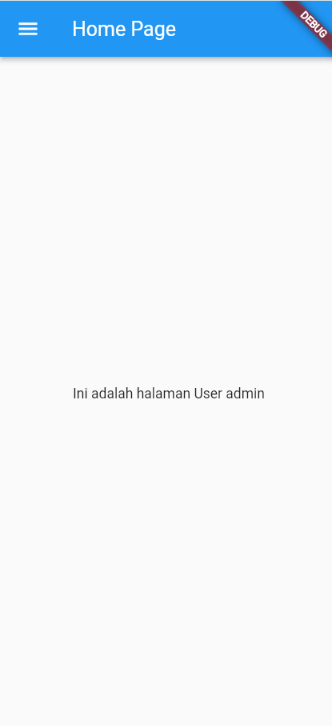

# Tugas Praktikum Pemrograman Mobile

Repository ini berisi hasil pengerjaan praktikum Pemrograman Mobile pada project `flutter_application_1`:

- **Modul 1:** Bahasa Pemrograman Dart (Struktur Data Queue FIFO)
- **Modul 2:** Pengenalan dan Desain Framework Flutter
- **Modul 3:** Routes, Side Menu, Login dan Local Storage

---

## 👤 Identitas Mahasiswa

| Informasi | Keterangan |
| :--- | :--- |
| **Nama** | Bunga Budi Ambar Wati |
| **NIM** | H1D024006 |
| **Shift KRS** | H |
| **Program Studi** | Informatika |

---

## 📋 Modul 1: Bahasa Pemrograman Dart

Implementasi struktur data Queue berbasis FIFO tersimpan di [`lib/main_backup.dart`](lib/main_backup.dart).

Menjalankan program melalui terminal:

```bash
dart run lib/main_backup.dart
```

**Hasil Eksekusi**

<p align="center">
  
</p>

---

## 📱 Modul 2: Pengenalan dan Desain Framework Flutter

Pada modul ini dibuat halaman **List Data Produk** (`ProdukPage`) menggunakan `ListView` dan `Card`.

**Tampilan List Data Produk**

<p align="center">
  
</p>

---

## 🔐 Modul 3: Routes, Side Menu, Login, dan Local Storage

Pada modul ini dibuat alur aplikasi dengan halaman login, halaman home, dan side menu (drawer) untuk berpindah halaman. Username yang berhasil login disimpan di local storage memakai package `shared_preferences`, lalu ditampilkan di halaman home. Login memakai akun simulasi `admin` / `admin`.

| File | Fungsi |
| :--- | :--- |
| `lib/login_page.dart` | Form login, validasi, dan menyimpan username |
| `lib/home_page.dart` | Halaman utama, menampilkan username dari local storage |
| `lib/sidemenu.dart` | Drawer berisi menu Home dan About |
| `lib/about_page.dart` | Halaman About |

**Tampilan Aplikasi**

<table align="center">
  <tr>
    <td align="center">
      <br/>
      <sub>Halaman Login</sub>
    </td>
    <td align="center">
      <br/>
      <sub>Pop-up Notifikasi</sub>
    </td>
  </tr>
  <tr>
    <td align="center">
      <br/>
      <sub>Halaman Home</sub>
    </td>
    <td align="center">
      <br/>
      <sub>Side Menu</sub>
    </td>
  </tr>
</table>

---

## 🚀 Cara Menjalankan Aplikasi

Pastikan dependensi sudah terpasang:

```bash
flutter pub get
```

| Platform | Perintah |
| :--- | :--- |
| Browser (Chrome / Edge) | `flutter run -d chrome` |
| Windows Desktop | `flutter run -d windows` |
| Android (Device / Emulator) | `flutter run` |
| Pengujian otomatis | `flutter test` |

> **Catatan:** Halaman awal pada `lib/main.dart` saat ini mengarah ke `LoginPage` (Modul 3). Untuk menampilkan hasil Modul 2, ubah properti `home` pada `MaterialApp` menjadi `ProdukPage()`.
